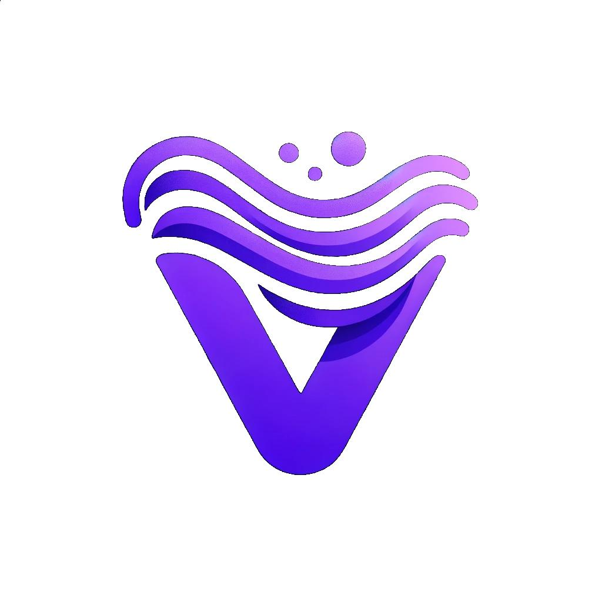
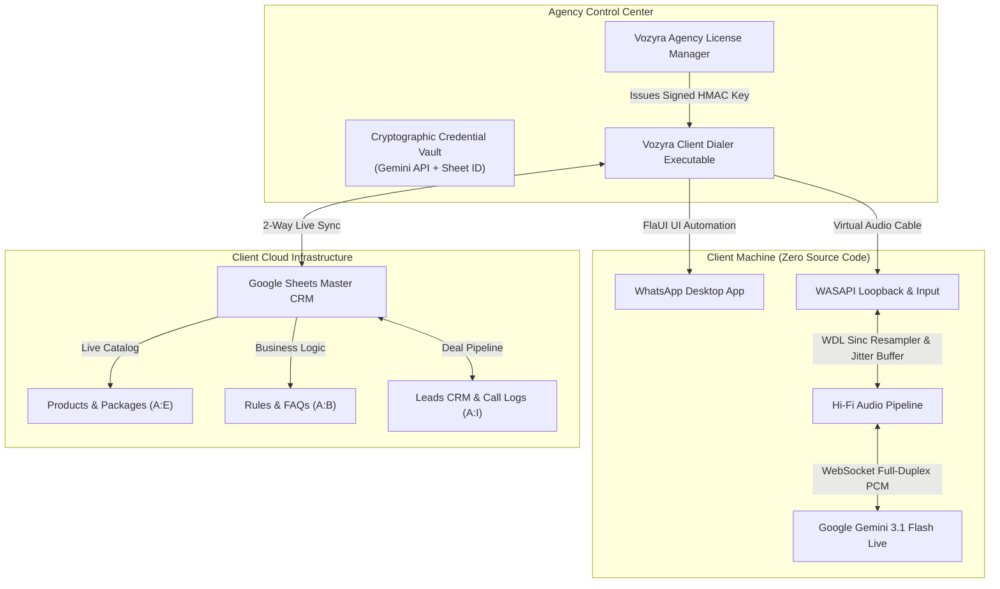

  
  
  # ⚡ VOZYRA AI VOICE SUITE
  ### *Universal Cross-Industry Closer & Marketer Engine for WhatsApp Desktop*
  
  

    <strong>Turn Inbound WhatsApp Inquiries & Cold Leads into Booked Deals in 45 Seconds.</strong> 
    Powered by Gemini 3.1 Flash Live WebSockets, Cockos WDL Sinc Hi-Fi Audio DSP, FlaUI UI-Automation, and 2-Way Google Sheets CRM Synchronization.
  

  

    
    
    
    
    
  

---

## 🌟 Executive Overview

**Vozyra AI Voice Suite** is an enterprise-grade autonomous voice dialer engineered to replace traditional, expensive call centers and robotic IVRs with a **hyper-convincing, high-status human sales closer and brand marketer**.

Running directly on top of native **WhatsApp Desktop (Windows)**, Vozyra automates the entire sales cycle:
1. **Dials inbound leads in under 45 seconds** before they ever check a competitor.
2. **Subtly extracts the prospect's exact pain points** through natural, disarming conversation—without the prospect realizing they are being queried.
3. **Prescribes exact products, pricing, and benefits** dynamically loaded in real-time from the client's **Google Sheet catalog**.
4. **Firmly assumes and locks in the close** (e.g., VIP showroom tour, test drive, complimentary cake tasting box, or Zoom demo).
5. **Automatically logs call outcomes, notes, summaries, and recordings** back into Google Sheets CRM in real-time.

---

## ⚡ The Vozyra Advantage

| Feature | Standard Human Sales Reps | Robotic IVRs / Script Bots | ⚡ Vozyra AI Closer |
| :--- | :--- | :--- | :--- |
| **Response Latency** | 2 to 24 Hours (leads go cold) | Instant (but robotic & annoying) | **< 45 Seconds (Instant WhatsApp Call)** |
| **Conversational Pitch** | Inconsistent, unmotivated, sick leaves | Static menu tree ("Press 1 for Sales") | **High-Status Consultative Closer** |
| **Pain Point Discovery** | Often forgets or skips qualification | None | **Subtle & Disguised Market Discovery** |
| **Multi-Industry Ready** | Needs weeks of training per sector | Pre-baked rigid software script | **Universal: Real Estate, Auto, Food, SaaS** |
| **Audio Latency & Clarity** | Depends on rep's microphone | Robotic robotic stutter & packet jitter | **Studio Hi-Fi (Cockos WDL Sinc Resampling)** |
| **CRM Data Entry** | 30% of calls forgotten / unlogged | Basic webhook only | **Instant 2-Way Sync (Notes, Stage, Audio)** |
| **Operating Cost** | \$3,000 – \$6,000 / month per rep | Flat software fee | **90% Lower Overhead / 24/7 Availability** |

---

## 🎯 Key Architectural Pillars

### 1. 🧠 Subtle Pain Point Discovery Engine ("Without Them Knowing")
Vozyra strictly prohibits robotic interrogation like *"What are your pain points?"*. Instead, it uses **psychological conversational observation**:
- **Real Estate**: *"A lot of buyers and investors we speak with find that either handover dates drag out, hidden service charges eat up yield, or payment plans are too rigid. When you look at options, what's been your biggest concern?"*
- **Automotive**: *"Most clients trading in tell us their biggest headache was dealers making them wait months for allocation or offering low trade-ins with hidden fees. In your current car, what's been bugging you the most?"*
- **Restaurants & Bakeries**: *"Whenever someone is organizing an event, their biggest dread is either dry, cookie-cutter food or the caterer arriving late and ruining setup. For your event, what is the one thing that simply must be 100% flawless?"*
- **Healthcare & Clinics**: *"Most patients who consult with us mention they were nervous about long recovery downtime, pain, or unnatural results. What's been the main thing holding you back?"*
- **B2B & SaaS**: *"In your industry we see companies bleeding revenue in one of three places: leads take hours to be called back, sales rep salaries are out of control, or everything is lost between spreadsheets and WhatsApp. Which of those gives you the biggest headache?"*

The AI **actively listens**, categorizes their pain, and dynamically pulls the exact solution from the client's Google Sheet catalog.

---

### 2. 📊 Live Dynamic Google Sheets Ingestion (Leads, Products, Rules, FAQs)
Vozyra does not require code recompilation to change business rules or inventory. It reads directly from Google Sheets:
- **`Products!A2:E`**: Ingests Product Name, Specifications, Pricing Packages, and Key Benefits.
- **`Rules!A2:B`**: Enforces strict commercial business rules (deposit terms, delivery radius, refund policies).
- **`FAQs!A2:B`**: Instantly resolves objections with client-approved answers.
- **`Leads!A2:I`**: Full 2-way CRM synchronization with automatic follow-up dates, deal stages, and call notes.
- **`Do Not Call (DNC) Safeguard`**: Immediate blocklist protection to ensure compliance.

---

### 3. 🎙️ Military-Grade Hi-Fi Audio DSP Engine
Built on top of **NAudio** and the industry-standard **Cockos WDL Sinc Resampler**:
- **Sinc Interpolation Resampling**: Seamless bidirectional resampling between Gemini Live's native 24kHz PCM, WhatsApp Desktop's 48kHz audio pipeline, and input mic 16kHz streams.
- **Speech Jitter Buffer (60ms–120ms Dynamic)**: Absorbs internet packet micro-bursts, eliminating audio clicks, stuttering, and metallic distortion.
- **Smooth Volume Ramp & Fade**: Prevents speaker pop when calls connect or disconnect.
- **WhatsApp Desktop Automation via FlaUI**: Zero-click automation simulating keyboard hooks (`Ctrl+Alt+Shift+C`), dynamic UI element tree resolution, and automated call hang-ups.

---

### 4. 🌐 Multilingual Closer with Strict Gender Agreement
Vozyra speaks four core enterprise business dialects with authentic cadence (~135-145 wpm), conversational connectors (`"Honestly..."`, `"Hundred percent..."`), and natural reaction tokens (`"Gotcha"`, `"Makes total sense"`):
- **English (US)**: Energetic, authoritative American sales closer.
- **English (UK)**: Articulate, polished British commercial director.
- **Gulf Arabic (اللهجة الخليجية البيضاء)**: Natural Gulf executive dialogue with strict feminine/masculine grammatical agreement (`أنا مديرة مبيعات` vs `أنا مدير مبيعات`).
- **Urdu (اردو)**: Dignified Pakistani corporate dialogue with strict gender verb agreement (`میں بات کر رہی ہوں` vs `میں بات کر رہا ہوں`).

---

### 5. 🛡️ Commercial Agency Licensing & Hardware Lock (Zero Code Exposure)
The suite includes the standalone **Vozyra Master Agency License Manager**:
- **Zero Source Code Leaks**: Clients receive **only compiled, obfuscated native binaries** (`Vozyra_AI_Voice_Dialer_Client_Setup.zip`).
- **Zero API/Credential Exposure**: The client never sees your Google Cloud `credentials.json` or Gemini API key. All credentials are cryptographically embedded inside the signed license key.
- **Anti-Cloning Hardware Lock (HWID)**: Cryptographically binds the license to the client PC's Motherboard UUID, CPU ID, and Machine SID via **HMAC-SHA256**.
- **Subscription Expiry & Daily Call Cap Enforcement**: Hard expiration dates and daily quota limits enforced mathematically.

---

## 🏛️ System Architecture

---

## 💼 Cross-Industry Showcase

### 🏡 Real Estate Developers & Agencies
- **The Angle**: Exclusive pre-launch pricing, guaranteed rental yields, and Golden Visa eligibility.
- **Subtle Pain Point**: Handover delays, hidden maintenance charges, rigid payment schedules.
- **The Close**: VIP private viewing or digital masterplan walkthrough.

### 🚗 Luxury & Fleet Automotive
- **The Angle**: Certified 150-point inspection, aggressive trade-in valuations, 5-year bumper-to-bumper warranty.
- **Subtle Pain Point**: Multi-month allocation delays, hidden dealership delivery fees.
- **The Close**: Priority VIP showroom test drive or on-site trade-in appraisal.

### 🎂 Gourmet Catering, Bakeries & Hospitality
- **The Angle**: Handcrafted custom artisanal cakes, corporate gourmet banquets, bespoke dietary customization.
- **Subtle Pain Point**: Boring food guests dislike, caterers arriving late and disrupting event schedules.
- **The Close**: Complimentary cake tasting box or reserving date before the kitchen reaches capacity.

### 🏥 Healthcare, Aesthetics & Specialized Clinics
- **The Angle**: Minimally invasive procedures, natural lasting rejuvenation, certified medical directors.
- **Subtle Pain Point**: Fear of painful downtime, unnatural results, or impersonal clinic staff.
- **The Close**: Private specialist assessment with 3D aesthetic simulation.

### 💻 Enterprise B2B & Software / SaaS
- **The Angle**: 45-second lead follow-up, 24/7 autonomous closing, 70% reduction in sales payroll.
- **Subtle Pain Point**: Inquiries slipping through the cracks, sales rep turnover, spreadsheet chaos.
- **The Close**: 10-minute live screen-share workflow walkthrough.

---

## 🚀 Client Quickstart (Running Pre-Compiled Package)

Clients do not need to install source code, compilers, or Git.

### 1. Download & Extract
Download `Vozyra_AI_Voice_Dialer_Client_Setup.zip` from your agency portal and extract it to any folder (e.g. `C:\Vozyra`).

### 2. Launch & Copy HWID
Run `WhatsappVoiceDialer.exe`. In the **License & Activation** tab:
1. Click **Copy HWID** to copy your unique machine hardware fingerprint.
2. Send your HWID to your Vozyra agency partner.

### 3. Activate License
1. Paste the signed **License Key** provided by your agency.
2. Click **Activate License**.
3. Vozyra instantly unlocks, connects to your dedicated Google Sheet CRM, and primes your voice persona.

### 4. Connect Audio & Start Calling
1. Open **WhatsApp Desktop** and ensure **VB-Audio Virtual Cable** is selected in WhatsApp Audio Settings.
2. Select your industry or customize your pitch in **Client & Script Settings**.
3. Click **Start Dialer Queue**!

---

## 📦 System Requirements

- **Operating System**: Windows 10 / Windows 11 (64-bit)
- **Runtime**: [.NET 10 Desktop Runtime (x64)](https://dotnet.microsoft.com/download)
- **Messaging**: Native WhatsApp Desktop app for Windows
- **Audio Driver**: [VB-Audio Virtual Cable](https://vb-audio.com/Cable/) *(Free virtual audio loopback driver)*

---

## 🔒 Security & Defense Summary

Vozyra is backed by a suite of 5 automated security verification checks:
- ✅ **HWID Anti-Cloning Lockout**: Protects against unauthorized copying to secondary PCs.
- ✅ **Cryptographic Tamper Defense**: Any modification to the license payload immediately invalidates the HMAC signature.
- ✅ **Subscription Expiration Enforcement**: Prevents unauthorized usage past subscription dates.
- ✅ **Fuzzing & Injection Attack Resistance**: Rejects corrupted, malformed, or injected inputs.
- ✅ **Secure Key Round-Trip Verification**: Verified seamless license activation across all tiers.

---

## 🤝 Commercial Licensing & Agency Inquiries

Vozyra is available under private commercial licenses and white-label agency partnerships.

- **Founder & Agency Owner**: Safee Ullah Mughal
- **Email**: [pkwaster@gmail.com](mailto:pkwaster@gmail.com)
- **GitHub**: [@Safee-Ullah-Mughal](https://github.com/Safee-Ullah-Mughal)
- **Repository**: [Vozyra AI Voice Suite](https://github.com/Safee-Ullah-Mughal/Vozyra)

---

  © 2026 Vozyra AI Technologies. All Rights Reserved. Commercial & Enterprise Distribution Only.

